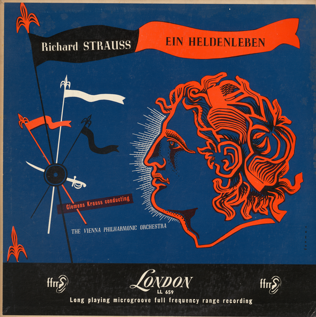
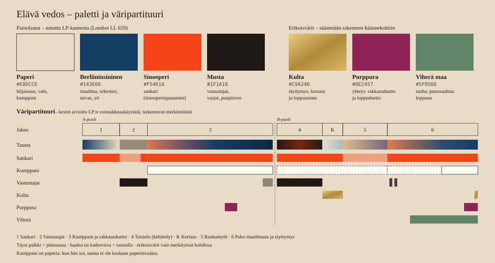

# Visuaalinen tyyli: Elävä vedos

*Versio 2. Korvaa version 1 ("elävä maalaus"). Perustuu [taustatutkimukseen](heldenleben_tutkimus.md),
Andrew Porterin kansitekstiin ja Clemens Kraussin LP:hen (London LL 659). Saman levyn
ääni ja kansi ovat projektin lähtökohta.*

## Tiivistelmä

Video on **saman LP-levyn uusi painos, tällä kertaa kuvana**. Ääni painettiin aikanaan
vinyyliin ja kansi paperille. Me painamme musiikin näkyväksi: yhdeksi pitkäksi
friisiksi, joka syntyy musiikin tahdissa kannen kolmella painovärillä kermanväriselle
paperille.

- **Kolme voimaa, kolme alkeismuotoa:** vastustajat ovat *pisteitä*, kumppani on
  *viiva* ja sankari on *taso*.
- **Teemat piirtävät itsensä:** muodot johdetaan Straussin melodioiden kaarista. Kun
  Strauss muuntaa teemaa, kuva muuntuu samalla tavalla.
- **Säästetyt värit:** kulta, purppura ja vihreä ilmestyvät vain teoksen
  käännekohdissa.
- **Levyn patina on kuvan patina:** LP:n rahina ja naksahdukset näkyvät paperin
  rakeisuutena ja pölynä, täsmälleen samoina hetkinä kuin ne kuuluvat.
- **Loppu:** friisi kiertyy levyn uraksi, ja sankarin elämästä tulee yksi äänilevy.
- **Elävä muste (luku 18):** sankari on punaista mustetta, joka hajoaa friisiksi ja kokoontuu
  taas hahmoksi. Melodiaviiva seuraa sävelkorkeutta tarkasti. Tunnemaisemat (auringonnousu, suo,
  myrsky) kertovat tarinaa, ja friisi on punainen lanka.

---

## 1. Kuuntelija keskiössä

Tavoite on **selventävä** kokemus: kuva auttaa korvaa. Selventävä kuva kertoo neljä
asiaa:

1. **Kuka soittaa:** sankari, kumppani, vastustajat vai koko orkesteri.
2. **Mitä teemalle tapahtuu:** palaako se, venyykö, pirstoutuuko vai vääristyykö.
3. **Missä kohtaa teosta ollaan:** jakso, vuorokaudenaika ja sonaattimuodon vaihe.
4. **Milloin on hiljaista:** tauot ja hengähdykset saavat tilansa.

**Mössöyttävä** kuva tekee päinvastoin: kaikki sykkii äänenvoimakkuuden tahdissa,
mikään ei erotu, efektit peittävät rakenteen ja kuva kertoo omaa tarinaansa musiikin
ohi.

Historian opetus tulee *Fantasiasta* (1940). Oskar Fischinger lähti Disneyltä, kun hänen
abstrakteja luonnoksiaan Toccata ja fuuga -jaksoon muutettiin esittävämmiksi.
Stravinsky taas arvosteli myöhemmin ankarasti *Kevätuhrin* käsittelyä. Kuva voi
epäonnistua kahteen suuntaan: liian kirjaimellisena se kertoo tarinaa musiikin ohi,
liian abstraktina siitä ei saa otetta. Me kuljemme välistä. Esittäviä aiheita
käytetään vain siellä, missä Straussin oma ohjelma on yksiselitteinen, ja muualla
kuvan kieli on graafista.

**Kaksi mittaria:**
- *Ilman ääntä* katsojan pitäisi pystyä päättelemään, kuka soittaa ja missä kohtaa
  teosta ollaan.
- *Äänen kanssa* kuulijan pitäisi kuulla enemmän, ei vähemmän.

## 2. Ydinidea: vedos

LP on painettua ääntä: matriisi prässää uran vinyyliin. Kansi on painettua kuvaa.
Kummassakin näkyy painamisen jälki, kuten rahina, rasteri, kohdistusvirheet ja pöly.
Tämä video on kolmas vedos samasta esityksestä.

| | Partituuri | Esitys | Vedos |
|---|---|---|---|
| 1950-luku | Strauss 1898 | Krauss ja Wienin filharmonikot | LP-levy ja sen kansi |
| 2020-luku | **koodi**, eli kuvan partituuri | **äänite**, sama esitys | **video ja friisi** |

Koodi on kuvan partituuri. Sama koodi eri äänitteellä tuottaa eri friisin, samalla
tavalla kuin sama partituuri tuottaa eri esityksiä.

> *Der Zeit ihre Kunst, der Kunst ihre Freiheit.*
> (Jokaiselle ajalle sen taide, taiteelle sen vapaus.)
> Lause on Wienin Secessionin talon julkisivussa. Talo valmistui 1898, samana vuonna
> kun Strauss sävelsi *Heldenlebenin*.

## 3. Perintö: jokaiselta lähteeltä yksi asia

Ehjä kokonaisuus syntyy siitä, että **jokainen referenssi tuo yhden tarkasti rajatun
asian**. Silloin lopputulos on järjestelmä eikä kollaasi.

| Kerros | Mitä otamme | Lähde | Miksi juuri tämä |
|---|---|---|---|
| **Muoto** | friisi: sankari, vihamieliset voimat ja täyttymys taiteessa | Gustav Klimt: *Beethoven-friisi* (1902), n. 34 m | sama tarina samalta aikakaudelta, ja itsessään musiikin tulkinta kuvana. Kultaisen ritarin esikuva oli Gustav Mahler |
| | elämä yhtenä päivänä, aamusta yöhön | Philipp Otto Runge: *Vuorokaudenajat* (1803–) | Runge suunnitteli sarjan osaksi kokonaistaideteosta runouden, musiikin ja arkkitehtuurin kanssa |
| | sonaattimuoto | Strauss ja Porterin analyysi | kuva saa saman rakenteen kuin korva |
| **Kielioppi** | piste, viiva, taso | Wassily Kandinsky: *Punkt und Linie zu Fläche* (1926) | kolme alkeismuotoa kolmelle voimalle. Kandinsky muutti Müncheniin 1896 ja ajatteli maalausta musiikkina |
| | korkeus = sävelkorkeus, muoto = melodiakaari | Stephen Malinowski: *Music Animation Machine* | kuuntelijaa auttavan visualisoinnin perusta |
| | johtoaiheet | Wagner → Strauss → elokuvamusiikki (Howard Shore: *Taru sormusten herrasta*) | sama tekniikka siirretään kuvaan |
| **Väri** | kolme painoväriä paperilla | LP-kansi (London LL 659) | värit on mitattu suoraan kannesta |
| | väridramaturgia | J. W. von Goethe: *Zur Farbenlehre* (1810) | Friedrichin ja Rungen aikalainen, antaa väreille merkityksen |
| | väristemma osana partituuria | Aleksandr Skrjabin: *Prometheus* (1910), *luce*-stemma | värit osana sävellystä |
| **Viiva** | kaiverrettu, paisuva viiva ja varjostus viivoituksella | Albrecht Dürer: *Ritari, kuolema ja paholainen* (1513), *Apokalypsi* (1498) | ritari vihollistensa keskellä. Saksalaisen grafiikan perusta |
| | piiskaviiva (*Peitschenhieb*) | Hermann Obrist (München, n. 1895), *Jugend*-lehti (München, 1896) | Straussin kaupunki ja hetki: hän aloitti teoksen Münchenissä 1898 |
| **Tila** | horisontti, tyhjyys, selkäkuva | Caspar David Friedrich | hiljaisuus ja kuuntelijan paikka kuvassa |
| | kerrostasot ja siluetit | Lotte Reiniger: *Prinssi Achmedin seikkailut* (1926) | varhainen multiplane-kamera, saksalainen keksintö |
| | tyylitelty fantasiamaisema | Eyvind Earle: *Prinsessa Ruusunen* (1959); Tolkienin omat *Hobitti*-kuvitukset | fantasian mittakaava ilman fotorealismia. Tolkienin kuvissa näkyy jugendin ja japanilaisen puupiirroksen vaikutus |
| **Liike** | ennakointi, jälkiliike, lavastus | Disneyn animaation periaatteet (Thomas & Johnston: *The Illusion of Life*, 1981) | animaation perussanasto |
| | sointiväri muuttaa viivan luonnetta | *Fantasia* (1940), välijakso "Meet the Soundtrack" | ääniraita, joka muuttaa muotoaan soittimen mukaan |
| | muotojen puhdas liike musiikin kanssa | Oskar Fischinger, Walter Ruttmann | saksalaiset visuaalisen musiikin pioneerit. Ruttmann teki myös *Achmedin* taustoja |
| **Materiaali** | silkkipaino, rasteri, kohdistus, paperi | LP-kansi; nykyinen risografia | painamisen jälki näkyy |
| | patina | LP:n oma rahina | ks. luku 9 |

### Mitä jätimme pois ja miksi

- **Böcklin, Bierstadt ja John Martin:** öljymaalauksen ilmaperspektiivi sotii
  painojälkeä vastaan. Ylevä mittakaava hoidetaan Friedrichin sommittelulla ja
  Earlen muodoilla.
- **Alan Lee, John Howe ja Peter Jacksonin elokuvat:** syy on sama. *Taru sormusten
  herrasta* -tunnelma tulee Tolkienin omista kuvista (litteitä, koristeellisia,
  jugendin ja japanilaisen puupiirroksen sukua) ja Howard Shoren johtoaiheista.
- **Version 1 volumetrinen sumu, valokiilat, bloom ja hehkuvat valo-olennot:** ne
  korvataan musteella. Valosta tulee paperia, liekistä sinooperinpunainen taso.

---

## 4. Kielioppi: piste, viiva, taso

### Kolme voimaa, kolme alkeismuotoa

| Muoto | Voima | Musiikillinen peruste |
|---|---|---|
| **Piste** | vastustajat | lyhyet, terävät staccato-iskut, nokkiminen, yksittäiset lautasiskut |
| **Viiva** | kumppani | yksi sooloviulu, eli yksi jatkuva melodialinja |
| **Taso** | sankari | käyrätorvien ja sellojen massa: melodia, jolla on painoa |
| *taustatasot* | maailma, eli orkesterin säestys | maisema, joka kantaa kaikkea |

Draaman voi lukea muotojen suhteista:
- Vastustajat nokkivat sankarin tasoa pisteillä.
- Rakkausduetossa viiva kietoutuu tason ympärille.
- Taistelussa pisteparvet hyökkäävät, taso repeää ja viiva leikkaa parven läpi.
- Loppuduetossa viivasta tulee tason ääriviiva, ja kaksi muotoa on yksi.

### Teemat piirtävät itsensä

Alkuperäinen suunnitelma oli merkitä jokaisen johtoaiheen melodiakaari partituurista
teemaluetteloon ([themes.example.json](../annotations/themes.example.json)). **Sitä ei tehdä
(29.10.2026):** melodioita ei lueta partituurista. Kaari saadaan analyysin rekisteristä ja
sävelkorkeudesta (A 0–400 s) sekä lähteiden teemakuvauksista (esimerkiksi sankariteema
nousee 3½ oktaavia). Teemojen paikat tässä äänitteessä ovat teemakartassa
([teemat.json](../annotations/teemat.json)). Kuvan muoto rakennetaan kaaresta:

- **Sankari:** tason yläreuna *on* sankariteeman kaari. Teema kattaa 3½ oktaavia
  yhdeksässä tahdissa, joten taso nousee laaksosta taivaalle, ruudun alareunasta
  yläreunaan.
- **Kumppani:** viiva *on* viulun melodia.
- **Dehring:** kaksi pistettä, joiden pystyetäisyys on aina kvintti.

Kartoitus pysyy samana koko videon ajan:

| Musiikki | Kuva |
|---|---|
| sävelkorkeus | korkeus ruudussa |
| aika | vaakasuunta (friisi) |
| voimakkuus | koko ja paino |
| artikulaatio | reunan terävyys: legato on pehmeä, staccato pisteitä |
| johtava ääni | täysi väri ja terävyys |

### Muunnokset

Kun Strauss muuntaa teemaa, kuva tekee saman muunnoksen. Muunnos merkitään
merkintätiedostoon kenttään `transform`.

| Musiikissa | Kuvassa |
|---|---|
| augmentaatio | muoto venyy leveäksi ja juhlavaksi |
| diminuutio | muoto tiivistyy ja nopeutuu |
| inversio | muoto peilautuu pystysuunnassa |
| fragmentointi | taso repeää kaistaleiksi, ja vain fragmentit jäävät |
| transponointi | muoto siirtyy ylös tai alas |
| vääristely (englannintorvi, vastustaja 7) | sankarin taso pisteinä: rasterikarikatyyri |
| kontrapunkti | useat muodot omilla kerroksillaan, kukin erotettavissa |
| paluu (kertaus) | sama muoto samassa kohdassa ruutua kuin ensimmäisellä kerralla |

---

## 5. Väri

### Painolaatat (mitattu LP-kannesta)

| Väri | Arvo | Kannessa | Rooli |
|---|---|---|---|
| Paperi | `#E8DCC6` | kerma, ikääntynyt `#D3B797` | hiljaisuus, valo, kumppani |
| Berliininsininen | `#143E66` | tausta, n. 55 % pinta-alasta | maailma, orkesteri, taivas, yö |
| Sinooperinpunainen | `#F5461A` | viiri, nauha, profiili (`#F84816`), n. 11 % | sankari |
| Musta | `#1F1A18` | lämmin painomusta, n. 22 % | vastustajat, varjot, puupiirros |

### Erikoisvärit (säästetään)

| Väri | Arvo | Milloin |
|---|---|---|
| Kulta (metallinen) | `#C9A24D` | täyttymys: kertaus ja loppusointu |
| Purppura | `#8E2457` | sankarin ja kumppanin yhteys: rakkausduetin huippu ja loppuduetto |
| Viherä maa (*terre verte*) | `#5F8566` | rauha: englannintorven pastoraalista loppuun |

**Miksi berliininsininen?** Kannen sininen ei ole ultramariinia vaan syvää,
berliininsinisen tyyppistä sävyä. Pigmentti keksittiin Berliinissä 1700-luvun alussa,
ja Strauss viimeisteli *Heldenlebenin* Berliinissä. Samalla pigmentillä Hokusai painoi
*Suuren aallon*, ja japanilainen puupiirros vaikutti Tolkienin omiin kuviin. Lisäksi
syanotypian ja piirustusten sinikopioiden (*blueprint*) sininen on sama yhdiste. Maailma
piirretään siis tekniikan omalla sinisellä.

### Väridramaturgia (Goethe)

- **Polariteetti:** lämmin ja aktiivinen sankari (sinooperi) vastaan viileä maailma
  (berliininsininen). LP-kansi on juuri tämä vastakohta.
- **Kohoaminen purppuraan:** Goethen mukaan värikehän navat kohoavat (*Steigerung*)
  ja kohtaavat purppurassa, jota hän piti korkeimpana värinä. Siksi purppura on
  varattu sankarin ja kumppanin yhteydelle.
- **Vihreä lepona:** Goethen värikehässä vihreä on purppuran vastapäätä,
  tasapainoisena sekoituksena, johon silmä lepää. Siksi vihreä on varattu rauhalle.
- **Musta sameutena:** vastustajat sameuttavat, ja niiden rasteri himmentää
  ympäröivät värit. Tämä on oma tulkintamme, ei Goethen.

### Säästämisen periaate

Strauss säästää kulissitrumpetit ja tenorituuban omiin hetkiinsä. Samoin video säästää
värejä:
- kulta näkyy vain kahdesti
- purppura näkyy vain kahdesti
- vihreä tulee vasta viimeisellä kymmenyksellä

Silloin katsoja tuntee, kun ne saapuvat.

**Sääntö:** jos jotain ei voisi painaa näillä seitsemällä värillä, se ei kuulu
videoon. Muut sävyt syntyvät päällepainatuksesta (värit kertautuvat kuin kalvot) ja
rasterista.

### Väripartituuri

| | 1 Sankari | 2 Vastustajat | 3 Kumppani | Rakkausduetto | 4 Taistelu | Kertaus | 5 Rauhantyöt | 6 Pako | Täyttymys |
|---|---|---|---|---|---|---|---|---|---|
| **Tausta** | aamunkoi: sininen → kerma | sameus: musta ja punainen rasteri | iltarusko | yö: sininen ja musta | musta, tulenpunainen | päivä: kerma, vaalea sini | kultainen iltapäivä → violetti hämärä | auringonlasku | iltasininen |
| **Sankari** | ● | ◐ → ● | ● | ● | ● | ● | ◐ | ● | ● |
| **Kumppani** | | | ● | ● | ◐ | ◐ | ◐ | ◐ | ● |
| **Vastustajat** | | ● | | ◐ ovella | ● | | | ◐ Dehring 2× | |
| **Kulta** | | | | | | ● | | | ● |
| **Purppura** | | | | ● huippu | | | | | ● |
| **Vihreä** | | | | | | | | ● pastoraali | ● |

● pääosassa · ◐ taustalla

---

## 6. Muoto: friisi

### Friisi

Koko video on yksi yhtenäinen friisi, joka painetaan musiikin edetessä. Kamera kulkee
sitä pitkin vasemmalta oikealle, kuin katse partituuria pitkin. Friisin leveys on
verrannollinen aikaan, joten tämän esityksen tempot näkyvät suoraan mittasuhteina.
Toisen äänitteen friisi olisi eri mittainen.

### Painokohta eli nykyhetki

- **Missä:** äänet painetaan noin kahden kolmasosan kohdalla ruudun leveydestä.
  Kohtaa ei piirretä näkyviin.
- **Vasemmalla:** juuri kuultu. Teeman muoto jää näkyviin muutamaksi sekunniksi, jotta
  silmä ehtii yhdistää äänen ja muodon. Pian painettu asettuu ja rauhoittuu.
- **Oikealla:** tyhjää paperia ja tulevien suurten tapahtumien haalea lyijykynäluonnos.
  Tämä on ennakointia, kuten muusikko lukee nuottia eteenpäin.

### Hiljaisuus on tyhjää paperia

Tauon aikana ei paineta mitään, ja friisiin jää valkoinen aukko. Dominanttiseptimin
jälkeinen tauko näkyy lopullisessa friisissä tyhjänä kohtana.

### Elämä yhtenä päivänä (Runge)

aamunkoi → aamupäivän sameus → ilta → yö → myrsky → keskipäivä (kertaus) → iltapäivä →
hämärä → yö

### Sonaattimuoto ja kameran liike

| Vaihe | Kamera |
|---|---|
| Esittely (jaksot 1–3) | kulkee friisiä pitkin |
| Kehittely (taistelu) | **sukeltaa friisin sisään** kerrostasojen läpi, kun teemat pirstoutuvat syvyydessä |
| Kertaus | palaa pintaan. Avauksen sommittelu toistuu samasta kulmasta täydessä valossa |
| Kooda (jaksot 5–6) | hidastuu ja vetäytyy |

### LP:n kaksi puolta: sivun kääntö

Voimakkuuskäyrän perusteella A-puoli loppuu noin 20½ minuutin kohdalla. Puolten raja
näyttää osuvan esittelyn ja kehittelyn väliin, rakkauskohtauksen ja taistelun välille.
**Tämä on vahvistettava korvakuulolta.**

Jos raja osuu sinne, puolenvaihdosta tehdään tarkoituksellinen hengähdys:

1. A-puolen viimeisen sävelen jälkeen kamera vetäytyy.
2. Esittelyn friisi kiertyy levyn uraksi. Syntyy A-levy, jonka renkaat ovat esittelyn
   väripartituuri.
3. Levy kääntyy, ja B-puolen sisäänajouran rahina kuuluu (noin 5–8 s).
4. Paperi aukeaa uudelleen, ja painaminen jatkuu kulissitrumpeteista.

Levyn omat tapahtumat, kuten puolenvaihto ja loppuura, ovat tapahtumia äänitteessä.
Siksi ne saavat näkyä. Vaihtoehto on saumaton liitos ilman taukoa.

### Loppu: friisi kiertyy levyksi

Täyttymyksessä kamera vetäytyy, ja B-puolen friisi kiertyy uraksi reunalta keskelle,
samaan suuntaan kuin levy soi. Renkaista näkyy draama:
- uloimpana taistelun musta ja punainen
- sitten kertauksen kultainen rengas
- rauhantöiden hämärä
- pastoraalin vihreä ja duetin purppura
- keskellä kultainen etiketti

Lopuksi A- ja B-levy ovat vierekkäin. Loppuuran rahina jatkuu, levy pyörii hitaasti ja
kuva häivytetään.

Sana *Vollendung* tarkoittaa sekä täyttymystä että valmistumista. Vedos valmistuu
täsmälleen täyttymyksessä.

---

## 7. Tila

### Pystysuunta on rekisteri (koko videon ajan)

| Ruudun osa | Rekisteri | Esimerkkejä |
|---|---|---|
| yläkolmannes, taivas | korkea | sooloviulu, huilu, viulut |
| keskikolmannes, horisontti | keski | alttoviulut, käyrätorvet ylärekisterissä, puupuhaltimet |
| alakolmannes, maa | matala | sellot, kontrabassot, tuubat, fagotit |

Sankari liikkuu maasta taivaalle (3½ oktaavia), ja kumppani elää taivaalla. Dehring
ryömii maassa. Huilukriitikko pistelee taivaalla, kumppanin alueella.

### Kerrostasot (multiplane)

1. pohja ja taivas
2. kaukainen horisontti (Friedrich)
3. keskimaisema (Earle)
4. **äänien taso**: pisteet, viiva, taso
5. etualan siluetit (Reiniger)
6. koristekehys (jugend), vain siirtymissä

Äänien taso on aina terävin ja kontrastiltaan vahvin.

**Kerrokset elävät soittimiensa mukaan, hienovaraisesti.** Jokaisella taustakerroksella on oma
soittimensa tai suureensa (rekisteri, dynamiikka, soitinperhe; aktiiviset soittimet kuunteluoppaasta
ja teemakartan `lead`-kentästä). Esimerkiksi kaukaiset harjanteet voivat hengittää rasteritiheydeltään
dynamiikan mukaan ja usvat liukua jousten mukana. Liike on hidasta ja tasoitettua, koska tausta on
säestystä: se ei reagoi yksittäiseen iskuun eikä vie huomiota etualalta. Staattinen tausta taas
hukkaa sen, mitä kerroksen piti edustaa (käyttäjän palaute 30.10.2026).

### Lavasteet eivät paljastu

Kamera ei koskaan näe lavasteen ulkopuolelle: ei kerroksen reunaa, katkeavaa vuorta, aukkoa eikä
paperin loppua. Paljastunut reuna rikkoo illuusion heti. Jokainen kerros ulottuu jokaisen kameran
näkymän yli omalla syvyydellään, ja tämä tarkistetaan koneellisesti jokaisessa ajossa.

### Yksi tuuli

Paikassa on yksi tuuli: kaikki viirit, viitat ja savut liehuvat samaan suuntaan, ja voima seuraa
musiikkia (jouset, voimakkuus). Eri suuntiin liehuvat viirit näyttävät sattumalta. Poikkeus on
taiteellinen valinta, jota musiikki tukee, ja se kirjataan kuvakäsikirjoitukseen.

### Jokaisella hahmolla oma tilansa

Hahmot ja viirit eivät mene päällekkäin, koska päällekkäisyys tekee kuvasta ristiriitaisen. Jokaisella
on oma syvyystasonsa ja välinsä, viiri kuuluu kantajalleen, eikä otsikko peitä hahmoa. Hahmo on
luettava omassa rajauksessaan: selvä siluetti ja yksi tunnistettava ele.

### Pääääni ja sivuääni

Schönbergin partituurimerkinnät *Hauptstimme* (H) ja *Nebenstimme* (N) kertovat
soittajalle, mikä ääni johtaa. Kuvassa toimitaan samoin:
- **Pääääni:** täysi väri ja terävä reuna.
- **Sivuääni:** rasteroitu sävy.
- **Säestys:** maailman sininen ja matala kontrasti.

### Tyhjä tila

Noin kolmasosa ruudusta on lähes aina tyhjää taivasta tai paperia (Friedrich). Se on
silmän hengähdyspaikka.

### Selkäkuva on kuuntelija

Friedrichin selkäkuva kutsuu katsojan katsomaan maisemaa samasta suunnasta, eli se on
kuuntelijan paikka kuvassa. Sankarin siluetti nähdään selkäpuolelta viiri mukanaan vain
neljästi:

1. avauksessa
2. dominanttiseptimin sädekehää vasten (kannen sädekehä uudelleen tulkittuna)
3. kertauksessa, samassa asennossa täydessä valossa
4. lopussa auringonlaskua katsomassa

Lisäksi rakkausduetossa voidaan kerran näyttää kaksi hahmoa selkäpuolelta katsomassa
kuuta, kuten Friedrichin maalauksessa *Mies ja nainen katsomassa kuuta*.

---

## 8. Liike

### Fraasit, ei iskut

Klassisessa musiikissa ei ole tasaista sykettä. Liike seuraa fraasien hengitystä, eli
alkaa ja loppuu pehmeästi, eikä reagoi tahdin iskuihin.

| Disneyn periaate | Käyttö |
|---|---|
| ennakointi | kuva valmistautuu huipennukseen (analyysissä katsotaan eteenpäin), ja luonnosviivat ilmestyvät |
| jälkiliike | viirit ja viivat jatkavat liikettä sävelen jälkeen kuin salin jälkikaiku |
| hidas alku ja loppu | fraasien kaaret |
| venytys ja litistys | vain vastustajille: groteski koomisuus |
| lavastus | yksi pääosa kerrallaan |
| liioittelu | vain huipennuksissa |
| sivutoiminta | säestys: jousten tremolo saa viivoituksen värisemään, harpun glissandot näkyvät väreinä vedessä ja patarummut nostavat pölyä maasta (koko kuva ei tärähdä) |

### Tahdistus

Kuvan isku tulee yhden ruudun (33 ms) ennen ääntä, kuten kapellimestarin lyönti tai
salama ennen jyrinää. ITU-R BT.1359:n mukaan katsoja huomaa vasta yli 125 ms myöhässä
tulevan äänen, joten 33 ms on turvallinen.

### Kirjoitetut iskut (käyttäjän linjaus 29.10.2026)

Tasaista sykettä ei kuvata. Säveltäjän *kirjoittamat* iskut sen sijaan saavat oman kuvaiskunsa
täsmälleen oikeaan kohtaan: soinnut pitkän fraasin keskellä, sforzandot ja kohtalokkaat katkot.
Iskun pitää olla tyylikäs ja kohtalokas, eikä se saa välkkyä.
- **Muoto tulee tarinasta ja soittimesta.** Isku on hahmon tai maailman teko, jonka sen soittimet
  tekevät. Kuvakäsikirjoitus määrää jokaiselle iskulle tekijän ja teon.
- **Elementti pärähtää, liike jatkuu (käyttäjän linjaus 30.10.2026).** Isku on aksentti
  jatkuvassa linjassa: fraasi jatkuu iskun läpi. Iskun tekee yksi elementti (salama, roiske,
  kellojen välähdys, pölypilvi, viirin napsahdus), ja se yllättää katsojan. Kamera ja hahmot
  jatkavat liikettään iskun ja sitä edeltävän katkon yli, koska jännite rakentuu liikkeessä.
  Koko kuvaa ei jähmetetä, välähdetä eikä täristetä, eikä iskuun leikata. Katko ennen iskua on
  sisäänhengitys: tuuli ja valo hiljenevät, liike ei. Ainoa koko kuvan muutos on yleistauko,
  jossa musiikki itse pysähtyy.
- **Hahmojen keho ei pompi iskuissa.** Viirit, valo ja luonto reagoivat iskuun, mutta hahmot
  liikkuvat fraasien mukaan (tasoitettu verhokäyrä, ei yksittäiset nuotinalut). Pomppiva hahmo
  näyttää nykivältä (käyttäjän palaute 30.10.2026).
- **Iskun lähteet:** ajat tulevat iskuanalyysistä (`aksentit.py`, 10 ms) ja partituurista.
  Merkittävät iskut ovat teemakartassa luokassa `isku`, ja niiden voimakkuus (z) määrää iskun
  koon.

### Pitkä sointu: liike hidastuu, ei pysähdy

Kun musiikki pysyy paikallaan (esimerkiksi pitkä sointu), liike hidastuu leijuvaksi: hidas
lähestyminen pitää jännitteen yllä. Täysi pysähdys vain, kun musiikki itse pysähtyy.

---

## 9. Materiaali ja levyn patina

### Painojälki

- **Laatat:** jokainen väri on oma laattansa eli renderöintikerroksensa. Laatat
  yhdistetään päällepainatuksena paperille, jolloin päällekkäisistä väreistä syntyy
  luonnollisia sekoitussävyjä.
- **Liukuvärit:** tehdään rasteripisteinä ja viivoituksena, ei digitaalisina
  liukuväreinä.
- **Kohdistus on harmoninen jännite:** dissonanssissa laatat liukuvat hiukan erilleen,
  kadenssissa ne loksahtavat kohdalleen. Jännite lasketaan sointuanalyysistä (chroma,
  tonnetz) ja merkinnöistä. Loppusoinnussa kohdistus on täydellinen.
- **Muste:** leviää hiukan ja peittää reunoilta epätasaisesti, kuten silkkipainossa.

### Levyn rahina kuvan patinaksi

Kuvan patina ei ole päälle liimattu filtteri. Se tulee **levyn omasta kohinasta**.
Analyysiä varten tehdään puhdistettu kopio, ja alkuperäisen ja puhdistetun erotus on
itse levyn ääni: rahina, sihinä ja naksahdukset.

| Levyssä | Kuvassa |
|---|---|
| pintakohinan taso | paperin rakeisuus ja kuitujen näkyvyys |
| naksahdus | pieni pölyhiukkanen tai mustetäplä samassa ruudussa. Isoimmat jäävät friisiin pysyviksi, kuten pöly painokaavassa |
| sisäänajoura (neula laskeutuu) | alku: tyhjä paperi herää rahinan tahtiin ennen ensimmäistä säveltä |
| puolenvaihto | sivun kääntö (ks. luku 6) |
| loppuura | loppu: levy pyörii, rahina jatkuu ja kuva häipyy |

### Säännöt

- **Patina pysyy paperissa.** Se ei koskaan kosketa pisteitä, viivaa tai tasoa.
- **Kontrasti on matala.** Silmä suodattaa pölyn samalla tavalla kuin korva suodattaa
  rahinan, joten patina jää taustaksi molemmille aisteille.
- **Ei filmirakeita, VHS-juovia eikä projektorin välkettä.** Ne kuuluvat väärään
  mediaan.

Patina on rehellistä: kuva näyttää sen, mitä kuulet, levy mukaan lukien.

---

## 10. Henkilöt

### Sankari: sinooperinpunainen taso

- **Muoto:** viiri tai nauha, jonka yläreuna on teeman kaari. Tason paksuus kasvaa
  vaskien ja jousten massan mukana.
- **Liike:** raskas ja juhlava, ja jälkiliike on pitkä kuin painavalla lipulla.
- **Tummana ja hiljaa:** kun sankari ei välitä vastustajista, taso on puoliksi
  rasteroitu ja mustalla päällepainettu, eli tummanpunainen.
- **Kun kärsivällisyys loppuu:** täysi sinooperi leimahtaa.
- **Sädekehä** (LP-kannesta): jokainen säde on yksi taajuuskaista, ja säteen pituus on
  kaistan energia. Sädekehä leimahtaa dominanttiseptimissä, kertauksessa ja
  loppusoinnussa.

### Kumppani: paperinvalkoinen viiva

- **Valoa:** kumppani on se kohta, johon mustetta ei paineta. Hän on piiskaviiva
  (Obrist), jonka viulu piirtää.
- **Aina erottuva:** kun kumppani soi, tausta ei koskaan ole paperinvaalea.
- **Mielialat (Porter):** ne muuttavat viivan luonnetta, kuten *Fantasian* ääniraita
  muuttaa muotoaan soittimen mukaan.

| Mieliala | Viiva |
|---|---|
| teeskennelty kaipaus | liian koristeelliset, riippuvat kiehkurat |
| iloisuus | kevyet, hyppivät kaaret |
| kevytmielisyys | katkeileva, sinkoileva viiva |
| hellyys | ohut, tasainen, pehmeä |
| sentimentaalisuus | hitaat, raskaat silmukat |
| riehakkuus | suuret koukerot |
| sarkasmi | terävä siksak |

Tarkat saksankieliset esitysmerkinnät tarkistetaan partituurista.

### Vastustajat: suon olennot (päivitetty 1.11.2026, käyttäjän päätös)

Vastustajat ovat **suon olentoja**: jokainen on yhden soittimen olento ja sama joka kerta (luku 18, Disney 1).
Olennon siluetti kantaa yhden piirteen soittimestaan, mutta se on olento eikä soitin. Vastustajat **nokkivat**
sankaria, joten ne ovat häntä pienempiä.

| # | Soitin | Olento | Koko (ritarin korkeus = 1) | Rekisteri (kuvasääntö 7) | Ele |
|---|---|---|---|---|---|
| 1 | huilu, "sehr scharf und spitzig" | hyttynen, runko huilun putki | pään kokoinen (noin 0,15–0,2 siipineen) | yläkolmannes | pistää, lentää pois |
| 2 | oboe, mutisee ja kiihtyy | sorsa, nokka rööri | noin 0,35–0,4 | keski, vedessä | ui, kiihtyy, sukeltaa |
| 3 | lautaset | yksi roiske | – | – | roiske veteen |
| 4 | englannintorvi, kromaattinen nousu | haikara, pitkä kaula | seisoessaan noin 0,5, hoikka | keski, paalulla | kävelee portaat, nousee siivelle |
| 5 | **Dehring**, 2 tuubaa kvintteinä | kaksi kotiloa, kuori tuuban kello | noin 0,3–0,35 kumpikin | alakolmannes, penkereellä | ryömivät rinnakkain, **aina kvintin päässä toisistaan** (pystysuunnassa) |
| 6 | oboe, kiihtynyt | sorsa | kuten 2 | keski | värisee |
| 7 | englannintorvi vääristää sankariteeman | haikara ja **sankarin taso pisteinä** (rasterikarikatyyri) | – | – | – |
| 8 | 2 fagottia | kaksi sammakkoa | noin 0,2–0,25 | alakolmannes, penkereen rinteellä | hyppivät |
| 9 | 3 sordinoitua pasuunaa | kolme varista | noin 0,3 | ylä/keski, puun oksalla | laskeutuvat leimasimen iskuna, tahra |

- **Koko on voimakkuus** (luku 4, sääntö 13.5): olennon koko kasvaa oman mitatun kanavansa mukaan, enintään noin
  1,5-kertaiseksi perusmitasta. Olento ei ole koskaan ritarin kokoinen.
- **Näkyy silloin kun soi** (luku 18): tulo ja lähtö ovat yksi liike, ei ilmestymistä.
- **Oma tila** (kuvasääntö 22): ei toisen olennon, ritarin, keihään eikä lavasteen päällä; kokonaan kuvassa
  (näkyvyystarkistin). Lavasteita ei lisätä olentojen tueksi (ei tukkia): penger, paalut ja puu riittävät.
- Yhdessä (kuoro, piiritys) vastustajat tuottavat **sameutta**: mustaa rasteriusvaa, joka himmentää kaiken
  ympäriltään. **Sankarin taistelu on taistelu selkeydestä,** ja voitto kirkastaa kuvan.
- Friisissä ja vedoksessa (absoluuttinen rekisteri) vastustajat ovat edelleen **pisteitä**: neulanpisteet, pisteparvi,
  pisteiden portaat, kaksi raskasta täplää kvintin päässä, kaksi hyppivää täplää, leimasimen tahra.

### Maailma: berliininsiniset taustatasot

Maailma on maisema, ja orkesterin säestys näkyy siinä sivutoimintana.

### Rauhantöiden tunnukset

Jugendin ex libris -henkiset medaljongit syttyvät järven pintaan Porterin antamassa
järjestyksessä. Kukin rakennetaan lainatun teeman kaaresta.

| Lainaus | Tunnus |
|---|---|
| *Don Juan* | liekki |
| *Also sprach Zarathustra* | nouseva aurinko (avauksen nouseva motiivi) |
| *Tod und Verklärung* | ylös nouseva valo |
| *Don Quixote* | tuulimylly, laiha ritari |
| *Till Eulenspiegel* | narrin kiemura |
| *Guntram* | harppu |
| *Macbeth* | tumma kruunu |
| *Traum durch die Dämmerung* (tenorituuba) | hämärä laskeutuu ja rasteri pehmenee |

### Englannintorven kaari

Vastustaja 7 vääristää sankariteeman pisteiksi. Finaalin pastoraalissa englannintorvi
muovaa teeman maalaiseksi melodiaksi. Silloin sama muoto palaa yhtenäisenä, pehmeänä
ja vihreänä tasona. Vihreä ilmestyy tässä ensimmäistä kertaa, ja vääristymä on
parantunut.

---

## 11. Jaksot

| Jakso | Aika ja tausta | Maisema | Päätapahtuma | Kamera | Pääreferenssi |
|---|---|---|---|---|---|
| **1 Sankari** | aamunkoi: sininen → kerma | vuoristo, sumumeri laaksoissa | taso nousee laaksosta taivaalle; sädekehä; tauko | sivuttain, nousee teeman mukana | Friedrich, LP-kansi |
| **2 Vastustajat** | aamupäivän sameus | suo ja kuolleet puut | yhdeksän pistettä; tumma taso; leimahdus | rauhallinen: hahmot ovat levottomia, kamera ei | Dürer, Kandinsky |
| **3 Kumppani ja rakkausduetto** | ilta → yö | metsäaukio ja joki | viiva saapuu; seitsemän mielialaa; Ges-duuri: kuutamojoki ja harppu väreinä; purppura; vastustajat kehyksen reunalla; kolme kulissitrumpettia kolmena viirinä horisontissa (musta, valkoinen, punainen) | hidastuu, duetossa lähes pysähtyy | Obrist, Friedrich, *Fantasia* |
| *puolenvaihto* | | | A-levy, sivun kääntö | vetäytyy | LP |
| **4 Taistelu** | myrsky: musta ja tulenpunainen | aukea kenttä puupiirroksena | kaikki muodot vastakkain; fragmentit; kohdistus hajoaa | sukeltaa syvyyteen | Dürer (*Apokalypsi*), Klimt (vihamieliset voimat) |
| **Kertaus** | keskipäivä: kerma ja vaalea sini | avauksen vuoristo samasta kulmasta | taso täydessä valossa; **kulta**; kohdistus loksahtaa | palaa pintaan | Klimt (kultainen ritari) |
| **5 Rauhantyöt** | kultainen iltapäivä → violetti hämärä | tyyni järvi | tunnukset syttyvät; *Traum*: hämärä laskeutuu | hidas liuku | Klimt (täyttymys runoudessa), jugend |
| **6 Pako maailmasta** | auringonlasku | vuoristoniitty | Dehring kahdesti; pastoraali: **vihreä**; duetto: **purppura** | hidastuu | Earle, Runge |
| **Täyttymys** | yö laskeutuu | – | **kulta** ja täydellinen kohdistus; friisi kiertyy levyksi | vetäytyy | LP |

---

## 12. Esimerkki: ensimmäiset neljä minuuttia

A-puoli 0:00–4:00:

1. **Neula laskeutuu.** Ruudulla on kermanvalkoinen paperi, jonka rakeisuus värähtelee
   sisäänajouran rahinan tahtiin. Oikealla näkyy haalea lyijykynäluonnos vuorista.
2. **Ensimmäinen sävel.** Sinooperinpunainen taso nousee laakson kaistalta, ja sen
   yläreuna seuraa sankariteeman kaarta. Yhdeksässä tahdissa se kurottaa taivaalle
   (3½ oktaavia). Kamera nousee mukana. Kun jouset liittyvät, vuoret painautuvat
   berliininsinisellä.
3. **116 tahtia tauotta.** Viiri aukeaa friisiä pitkin. Sankarin luonteenpiirteet
   (mielikuvitus, palo, pyrkimys, suoraselkäisyys) näkyvät tason muodon muunnelmina.
4. **Kohti huippua.** Oikealle ilmestyy sädekehän luonnos, ja laatat alkavat liukua
   erilleen harmonisen jännitteen kasvaessa.
5. **Dominanttiseptimi.** Sädekehä leimahtaa vuorenhuipulla seisovan selkäkuvan takana.
   Laatat ovat kauimpana kohdistuksesta, koska sointu jää ratkaisematta.
6. **Tauko.** Painaminen pysähtyy. Kamera liukuu tyhjän paperin yli, ja vain levyn
   rahina välkehtii pölynä. Hiljaisuus näkyy.
7. **Vastustajat.** Ensimmäinen piste, neulanterävä huilu, pistää paperiin. Laatat
   jäävät epäkohdistukseen, koska kriitikot eivät anna soinnun ratkaista.

LP:n voimakkuuskäyrässä on jyrkkä pudotus juuri neljän minuutin kohdalla, −28 dB:stä
−44 dB:iin. Se on tämä dominanttiseptimi ja tauko.

---

## 13. Selkeyden säännöt

1. Mikään ei liiku ilman musiikillista syytä.
2. Yksi pääosa kerrallaan, ja pääääni on aina selkein.
3. Sama musiikki näyttää aina samalta.
4. Muoto tulee teemasta.
5. Ylös on korkea sävel, oikealle on aika, koko on voimakkuus.
6. Kuvan tiheys seuraa orkestraation tiheyttä, ei äänenvoimakkuutta.
7. Hiljaisuus on tyhjää paperia.
8. Liike seuraa fraaseja, ei iskuja.
9. Ei hehkua, sumennusta eikä hiukkassumua. Liukuvärit tehdään rasterina ja
   viivoituksena.
10. Erikoisvärit säästetään rakenteen käännekohtiin.
11. Kuva ennakoi kuin kapellimestarin lyönti.
12. Kuva ei keksi tapahtumia. Miljöö saa olla keksitty, tapahtumat eivät.
13. Patina pysyy paperissa.
14. Jos jotain ei voisi painaa seitsemällä värillä, se ei kuulu videoon.

---

## 14. Teknologia ja taide 2020-luvulla

Jokainen aikakausi on painanut omalla tekniikallaan:
- Dürer kaiverruspiikillä ja puulaatalla
- jugend kivipainolla
- Reiniger multiplane-kameralla
- Decca levyprässillä (ffrr) ja silkkipainetulla kannella
- Skrjabin valopianolla

Meidän tekniikkaamme ovat näytönohjaimen shaderit, konekuuntelu ja tekoäly, joka
kirjoittaa koodia. Jatkumo on sama: jäljentämisen tekniikka on taiteen väline.

1. **Koodi on käsityötä, ei kuvageneraattori.** Jokainen kuva piirretään luettavalla
   ja deterministisellä koodilla, eikä tekoälyn tuottamia kuvia käytetä. Claude
   kirjoittaa koodia kuten kaivertaja kaivertaa laattaa, ja ihminen päättää. Jokainen
   muoto voidaan jäljittää musiikilliseen syyhyn.
2. **Muusikko silmukassa.** Konekuuntelu (taso A) ja merkinnät (taso C: lähteiden
   tapahtumajärjestys, analyysin ajat ja korvalla tehdyt vahvistukset) toimivat yhdessä. Muusikon korva on tarkin analysaattori, kone väsymätön
   painaja.
3. **Esitys painaa kuvan.** Friisi on juuri tämän esityksen vedos: siinä näkyvät
   Kraussin tempot, Wienin filharmonikkojen dynamiikka ja jopa levyn pöly. Toinen
   äänite, vaikka oman orkesterisi, painaisi eri friisin. Tulkinnat tulevat näkyviksi
   ja vertailtaviksi.
4. **Digitaalisesta takaisin paperille.** Friisin ja levykuvat voi painaa risografilla
   tai silkkipainona samoilla erikoisväreillä, esimerkiksi julisteeksi konserttiin.
   Silloin ympyrä sulkeutuu LP-kanteen.
5. **Avoin painos.** Kaikki on koodia ja dataa. Uuden painoksen voi ajaa milloin
   tahansa, ja se on bitilleen samanlainen.

---

## 15. Mitä vältämme

- kaikki sykkii äänenvoimakkuuden tahdissa
- kuva välkkyy iskujen tahdissa
- hehku, linssiheijastukset, hiukkassumu ja liikesumennus
- jatkuva kameran tärinä
- tarina, jota musiikissa ei ole
- liian monta hahmoa yhtä aikaa
- sattumanvaraiset värinvaihdot ja digitaaliset liukuvärit
- fotorealismi, kasvot ja realistinen nivelistä liikkuva hahmoanimaatio (musteesta kokoontuva
  kasvoton hahmo sallitaan, luku 18)
- tekoälyn tuottamat kuvat
- LP-kannen, maalausten tai elokuvien jäljentäminen: otamme periaatteita, emme kuvia
- filmirakeet, VHS-juovat ja projektorin välke

---

## 16. Ennen tuotantoa

1. **Värikoe:** [paletti.svg](paletti.svg) ja päällepainatustesti koodilla.
2. **Tyylikuvat:** seitsemän still-kuvaa koodilla, yksi kustakin jaksosta ja
   kertauksesta. Ne hyväksytään ennen animointia.
3. **Animaatioluonnos:** ensimmäiset neljä minuuttia (A-puoli 0:00–4:00), eli
   sankariteema, dominanttiseptimi ja tauko.
4. **Selkeystesti:** katsoja ilman ääntä (tunnistaako hän, kuka soittaa?) ja äänen
   kanssa (kuuleeko hän enemmän?). Sinä arvioit muusikkona.
5. Vasta sitten tuotanto, jakso kerrallaan.

## 17. Avoimet kysymykset

1. **Puolenvaihto:** *ratkaistu analyysilla 29.10.2026.* Kulissitrumpetit ja taistelun alku
   ovat vielä A-puolella, ja A-puoli katkeaa kesken taistelun. B-puoli jatkaa taistelua.
   Ajat ovat kuunteluoppaassa; B-puolen alun mahdollinen päällekkäisyys tarkistetaan korvalla.
2. **Puolenvaihdon käsittely:** sivun kääntö tauon kanssa (suositus) vai saumaton
   liitos?
3. **Loppuduetto:** analyysissä käyrätorvi- ja viulusoolot vuorottelevat juuri ennen
   loppufanfaaria; vahvistetaan korvalla (kuunteluoppaan tarkistuslista).
4. **Teemaluettelo:** *ratkaistu 29.10.2026.* Melodiakaaria ei merkitä partituurista;
   teemakartta (`annotations/teemat.json`) korvaa teemaluettelon.
5. **Painotuote:** kiinnostaako friisi tai levykuva myös paperilla?
6. **Selitetty painos:** tehdäänkö lisäksi versio, jossa teemojen nimet näkyvät
   pieninä jugend-kuvateksteinä ensiesiintymisellä, esimerkiksi konserttiesittelyä
   varten?

---

## 18. Elävä muste ja Disneyn opit (lisätty 30.10.2026)

*Käyttäjän linjaus 30.10.2026: pelkkä friisi on liian staattinen (hylätty jo kerran, `video-400`). Video
kertoo Disney-henkisesti sankarista, joka tekee asioita tunnemaisemissa: auringonnousu, suo, myrsky ja
salamat. Friisi on punainen lanka taustalla. Lähteet: [tutkimus_disney.md](tutkimus_disney.md) ja
[tutkimus_muste.md](tutkimus_muste.md).*

### Miksi mustetaide kuuluu tähän vedokseen

Japonismi ei ole vieras lisä vaan saman aikakauden lähde:
- Bingin *Japanischer Formenschatz* (1888–91) toi japanilaiset muodot saksankieliseen taidemaailmaan.
- Münchenissä Eckmann teki japonistista grafiikkaa ja Orlik ensimmäiset väripuupiirroksensa (1896).
- Wienin Secessionin 6. näyttely vuonna 1900 oli kokonaan japanilaista taidetta, ja Klimt keräsi sitä.
- Berliininsininen on Hokusain *Suuren aallon* väri.

Mustemaalaus on siis saman vedoksen toinen tekniikka. Siitä otetaan periaatteet, ei teoksia.

### Muste painovärinä

| Mustetaiteessa | Vedoksessa |
|---|---|
| **sumi**, musta muste | musta laatta: vastustajat, varjot ja maa |
| **shuniku**, punainen leimamuste (kinaberia eli sinooperia) | **sankari on punaista mustetta.** Sama väline, kaksi pigmenttiä, joten sankari ei sekoitu mustiin vastustajiin. Punainen leima on maalauksessa tekijän merkki, ja tässä teoksessa tekijä on Strauss itse. |
| **ma**, tyhjä tila; Tōhakun *Mäntymetsän* sumu on paljasta paperia | hiljaisuus ja sumu ovat tyhjää paperia (luku 6, sääntö 13.7). Sumua ei sumenneta (sääntö 13.9). |
| **bokashi**, painettu sävyliuku | liukuvärit rasterina (luku 9) |
| **nijimi**, musteen leviäminen paperiin | märän reunan rasteri (ditteri), ei läpinäkyvyyttä |
| **kasure**, kuivan siveltimen rakoilu | Fraasin loppu: muste ehtyy, ja veto rakoilee hengityksen loppuessa. |
| **haboku/hatsuboku**, roiskemuste | kirjoitettu isku: yksi läiskä, joka jää friisiin |
| **ensō**, yhdellä vedolla piirretty ympyrä | levy lopussa: friisi kiertyy ensōksi |
| **hanko**, punainen leima | Kohtaloiskut voivat painua punaisina leimoina. Leimaaminen on sama ele kuin levyn prässäys. |

### Muste elää musiikin mukana

| Musiikki | Muste |
|---|---|
| legato, pitkä fraasi | yksi siveltimenveto: leveys paineesta (voimakkuus) ja kasure fraasin lopussa |
| staccato | tippoja ja pisteitä (vastustajat) |
| kirjoitettu isku | yksi läiskä tai leima iskun ruudulla, ja jälki jää friisiin |
| crescendo | sivellin painuu raskaammin, ja vedot sulautuvat massaksi |
| tremolo | märkä reuna värisee ja leviää hitaasti |
| harpun glissando | muste levittäytyy veteen renkaina |
| hiljaisuus | muste kuivuu, ja paperi jää tyhjäksi |

**Raja:** muste elää vedossa, roiskeessa ja leviämisessä, mutta koko kuva ei läikähdä jokaisessa
äänessä. Iskun tekee yksi läiskä, ja liike seuraa fraasia (luku 8).

### Sankari musteena: hahmo, joka hajoaa friisiksi ja kokoontuu taas

Sankari on maalattu punaisilla siveltimenvedoilla (12–30 vetoa, kuin kalligrafinen merkki). Siksi hän
voi muuttaa olomuotoaan musiikin mukaan:
- **Kun musiikki on melodiaa**, hänen vetonsa juoksevat friisiin viivaksi, joka piirtää teeman.
- **Kun musiikki on toimintaa** (taistelu, arvostelijat, nousu), vedot kokoontuvat taas hahmoksi.
- **Taistelun huipussa** hahmo repeää roiskeiksi ja vedoiksi, ja hetkessä hän kokoontuu taas.

Esikuva on Takahatan *Kaguya-hime*, jossa hahmo hajoaa viivojen pyörteeksi. Hajoamisen ja
kokoontumisen hetket tulevat ankkureista eivätkä keksitystä ajoituksesta.

Tämä tarkentaa lukua 15: vältettävää on realistinen, nivelistä liikkuva hahmoanimaatio ja kasvot.
Musteesta kokoontuva, kasvoton hahmo kuuluu vedokseen.

### Melodiaviiva seuraa sävelkorkeutta tarkasti

Kun viiva näyttää melodiaa, sen on seurattava sävelkorkeutta täsmällisesti. Epämääräinen suhina ei
kelpaa. Melodiaa ei näytetä koko ajan, vaan silloin, kun se halutaan tuoda esiin. Tärkein esimerkki
on **sankariteema käyrätorvissa ja selloissa alusta alkaen**:
- Teema nousee Es2:sta Es-duurikolmisointua ylös yli kolmen oktaavin, ja jokainen harppaus näkyy
  friisissä samassa suhteessa (ylös = korkea, luku 4).
- **Muoto tulee partituurista:** sävelten järjestys ja likimääräinen paikka tahdeissa. Käyttäjä
  hyväksyi partituurin käytön tähän 30.10.2026, vaikka partituuri on muuten vain tarkistusta varten.
- **Tarkka sävelkorkeus ja ajoitus tulevat äänestä** (`analysis/teemaviiva.py`): spektrin
  harmoninen summa levyn kohinan yläpuolella, ja haku rajataan partituurin muodon ympärille.
  CREPE ei tavoita teeman unisonoalkua matalalla, mutta spektri tavoittaa. Näin viiva seuraa
  kuultua esitystä ja Kraussin rubatoa, ei nuottikuvaa.
- **Testi:** viivan korkeus ruudulla poikkeaa mitatusta sävelestä enintään puoli puolisävelaskelta.

### Disneyn opit (menetelmä, ei makeus)

1. **Soitin = hahmo = muoto** (*Peter ja susi*). Sitoumus pysyy koko videon ajan: käyrätorvet ovat
   sankari, sooloviulu kumppani, ja jokainen arvostelijasoitin on sama olento joka kerta.
2. **Kolme musiikin lajia samassa teoksessa** (Deems Taylor, *Fantasia*):
   - kertova (sankari, arvostelijat, taistelu): esittävä kuva
   - kuvaileva (aamunkoitto, myrsky, kuutamo): maisema ja luonnonvoima
   - absoluuttinen (pitkät melodiat): friisi ja viiva

   Heldenlebenissä lajit vaihtuvat jaksoittain, ja kuva vaihtaa rekisteriä niiden mukana.
3. **Luonnonvoima on tunteen ilmaus.** Pastoraalin myrsky on kiukkua ja Tulilintu tuhoa ja
   uudestisyntymää. Auringonnousu, suo, myrsky ja salamat herättävät tunteita, joten niitä
   käytetään, mutta ilman hehkua: salama on paperin leikkaus tai musteen veto.
4. **Nuotti nuotilta vain iskuihin.** Eric Larson: Fantasiassa kuvausarkeilla oli "nuotti nuotilta,
   aivan kuin dialogi". Meillä klikkiraita on teemakartta ja `aksentit.json`. Rauhalliset jaksot
   kulkevat pitkillä kaarilla, kuten *Ave Marian* yhtenäinen otto pimeästä valoon. Jos jokainen
   nuotti peilataan, tuloksena on Eislerin moittima "kuvitustekniikka".
5. **Abstraktio ei saa olla "pikkusievää".** Walt hylkäsi Fischingerin pienet kolmiot, koska ne
   eivät kantaneet valkokankaalla. Pisteet ja vedot mitoitetaan niin, että ne luetaan
   kontaktiarkissa.
6. **Musiikki on kiinteä, ja kuva taipuu.** Disneyn virhe *Kevätuhrissa* oli partituurin
   lyhentäminen kuvan ehdoilla, ja siitä tuli Stravinskyn kritiikki. Meillä ääntä ei muokata.
7. **Lavastus:** yksi selvä ajatus kerrallaan ja luettava siluetti.
8. **Ennakointi ja jälkiliike:** kapellimestarin kohotus ennen tuttia ja kaiku iskun jälkeen.
9. **Älä lainaa makeutta.** Kitsch syntyi, kun kauneutta haettiin söpöydellä. Vedos saa kauneutensa
   painojäljestä, Dürerin viivasta, Friedrichin tyhjyydestä ja musteen vedosta.

---

## Lähteet

- [Beethoven Frieze (Wikipedia)](https://en.wikipedia.org/wiki/Beethoven_Frieze)
- [classical-music.com: The Beethoven frieze](https://classical-music.com/articles/beethoven-frieze)
- [Vienna Secession (Wikipedia)](https://en.wikipedia.org/wiki/Vienna_Secession)
- [Philipp Otto Runge (Wikipedia)](https://en.wikipedia.org/wiki/Philipp_Otto_Runge)
- [Theory of Colours (Wikipedia)](https://en.wikipedia.org/wiki/Theory_of_Colours)
- [SWG Kunstlexikon: Farblehre](https://www.suedwestgalerie.de/kunstlexikon/kunstgeschichte/farblehre)
- [Philarchive: Goethe, Purpur ja vihreä](https://philarchive.org/archive/MLLJRU)
- [Point and Line to Plane (Wikipedia)](https://en.wikipedia.org/wiki/Point_and_Line_to_Plane)
- [Stephen Malinowski (Wikipedia)](https://en.wikipedia.org/wiki/Stephen_Malinowski)
- [Prometheus: The Poem of Fire (Wikipedia)](https://en.wikipedia.org/wiki/Prometheus:_The_Poem_of_Fire)
- [Knight, Death and the Devil (Wikipedia)](https://en.wikipedia.org/wiki/Knight,_Death_and_the_Devil)
- [Hermann Obrist (Wikipedia)](https://en.wikipedia.org/wiki/Hermann_Obrist)
- [Jugend (Wikipedia)](https://en.wikipedia.org/wiki/Jugend_(magazine))
- [Wanderer above the Sea of Fog (Wikipedia)](https://en.wikipedia.org/wiki/Wanderer_above_the_Sea_of_Fog)
- [The Adventures of Prince Achmed (Wikipedia)](https://en.wikipedia.org/wiki/The_Adventures_of_Prince_Achmed)
- [Lotte Reiniger (Wikipedia)](https://en.wikipedia.org/wiki/Lotte_Reiniger)
- [Eyvind Earle (Wikipedia)](https://en.wikipedia.org/wiki/Eyvind_Earle)
- [Tolkien Studies: Hobitin kansikuva ja japanilainen puupiirros (Project MUSE)](https://muse.jhu.edu/article/513823)
- [Fantasia (Wikipedia)](https://en.wikipedia.org/wiki/Fantasia_(1940_film))
- [Oskar Fischinger (Wikipedia)](https://en.wikipedia.org/wiki/Oskar_Fischinger)
- [Prussian blue (Wikipedia)](https://en.wikipedia.org/wiki/Prussian_blue)
- [Audio-to-video synchronization, ITU-R BT.1359 (Wikipedia)](https://en.wikipedia.org/wiki/Audio-to-video_synchronization)
- Luku 18: [tutkimus_disney.md](tutkimus_disney.md) ja [tutkimus_muste.md](tutkimus_muste.md) (lähteet niissä)
